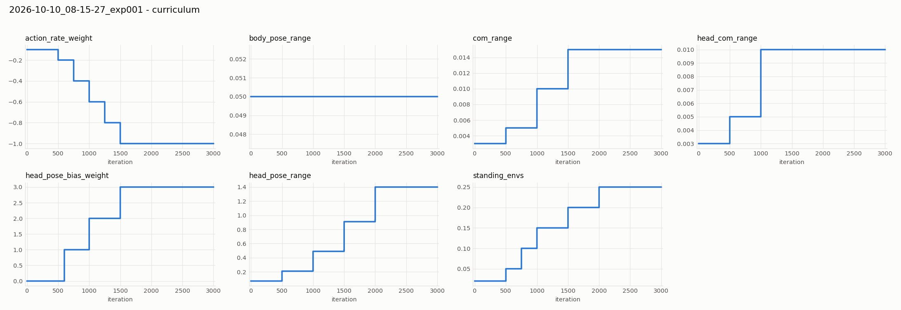
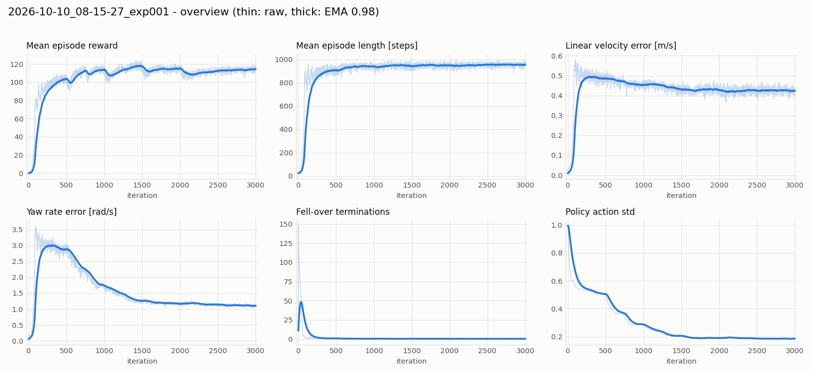
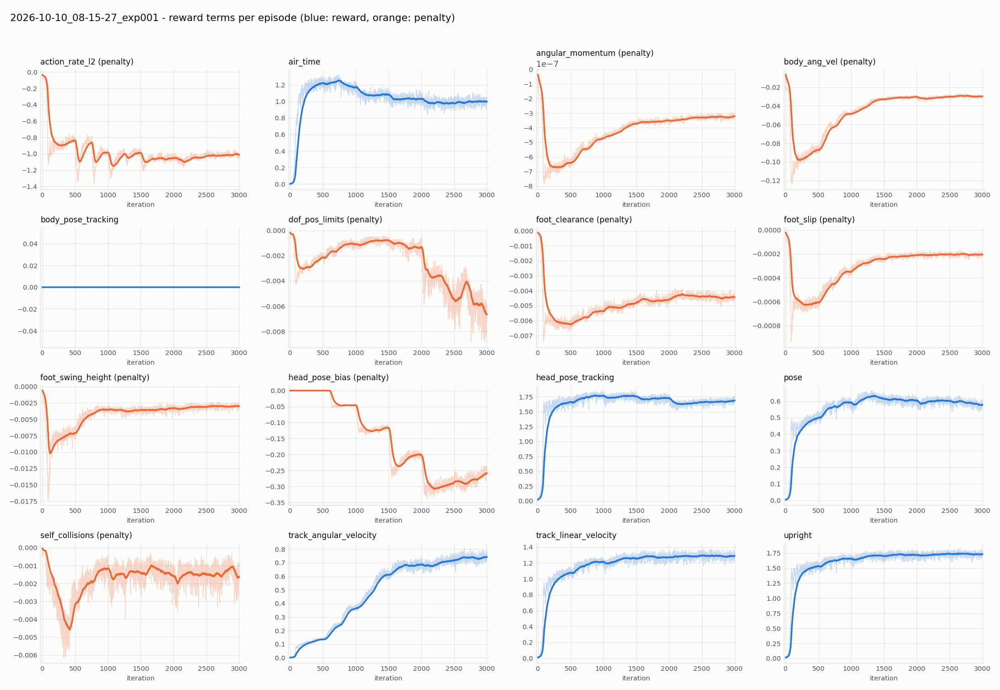
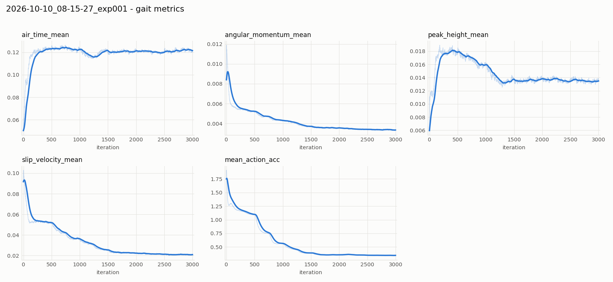
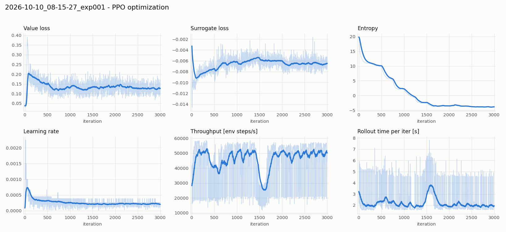
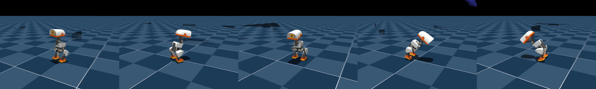
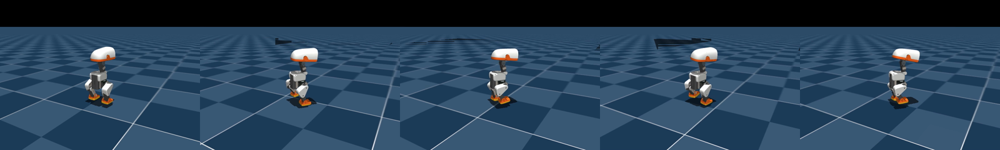
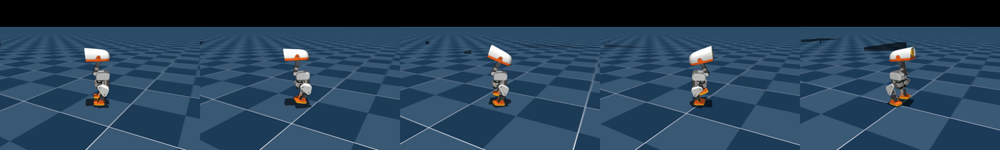
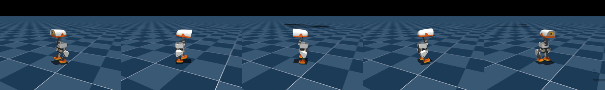

# exp001 学習サマリ: Microduck 歩行（Velocity-Flat）ベースライン

- run: `2026-10-10_08-15-27_exp001`（タスク `Mjlab-Velocity-Flat-MicroDuck`、公式設定を無改変）
- 実行環境: ローカル RTX 3090 / Docker、4096 並列環境、3000 iteration、所要 1 時間 57 分
- 設定の出典: 本ディレクトリの `params/env.yaml`, `params/agent.yaml`（学習時に自動保存されたもの）

---

## 1. 何を学習したか

Microduck（約 800 g・身長 約 25 cm の二足ロボット）が、**速度指令（前後・左右・旋回）に従って平地を歩きつつ、
頭部の姿勢指令にも追従する**ための方策を強化学習（PPO）で獲得させた。

| 項目 | 内容 |
|---|---|
| シミュレータ | MuJoCo Warp（mjlab 1.3.0）、物理 200 Hz（dt = 5 ms） |
| 制御周期 | 50 Hz（decimation 4）。1 エピソード最大 20 秒 = 1000 ステップ |
| 自由度 | 14 関節：脚 5×2（hip yaw / roll / pitch, knee, ankle）＋ 頭 4（neck_pitch, head_pitch, head_yaw, head_roll） |
| アクチュエータ | BAM モデル（Dynamixel XL330 系の電流・摩擦・電圧降下を再現する物理モデル）。PD 位置制御、kp_fw = 200 |
| 指令（コマンド） | 並進速度 x ∈ ±0.4 m/s, y ∈ ±0.3 m/s、旋回 ±1.0 rad/s（3〜8 秒ごとに再サンプル）＋ 頭部 4 関節の目標姿勢（2〜5 秒ごと） |

### 1.1 方策モデル（Actor-Critic）

```
観測(actor) ──► [正規化] ──► MLP 512-256-128 (ELU) ──► 14 関節の目標角（デフォルト姿勢からのオフセット）
観測(critic) ─► [正規化] ──► MLP 512-256-128 (ELU) ──► 状態価値 V(s)
```

- **Actor の入力**（実機で取れる量のみ、ノイズ付き）: 胴体角速度、重力方向（IMU 姿勢）、関節角、関節角速度、
  前回の行動、速度指令(3)、頭部姿勢指令(4)、胴体姿勢指令(6)
- **Critic の入力**（特権情報あり、学習時のみ使用）: 上記＋胴体の並進速度、足の高さ・接地・滞空時間・接触力
- 行動分布: ガウス分布（初期 std = 1.0、全関節共通のスカラー std）
- 出力: `action × 1.0 + デフォルト関節角` を PD 制御の目標角として送る

この「Actor には実機で観測できる量だけ、Critic には特権情報も」という非対称構成（asymmetric actor-critic）は、
sim2real を前提とした標準的な設計。

### 1.2 PPO ハイパーパラメータ

| パラメータ | 値 | パラメータ | 値 |
|---|---|---|---|
| ロールアウト長 | 24 step/env（= 98,304 サンプル/iter） | 学習エポック × ミニバッチ | 5 × 4 |
| 学習率 | 1e-3（KL 目標 0.01 で適応調整） | γ / λ (GAE) | 0.99 / 0.95 |
| クリップ | 0.2 | エントロピー係数 | 0.01 |

3000 iter で約 2.95 億ステップ ≒ **シミュレーション内時間で約 68 日分**の歩行経験。

---

## 2. 報酬設計

報酬は「やってほしいこと（正の項）」と「やってほしくないこと（負の項・ペナルティ）」の重み付き和。
追従系の項は誤差に対する `exp(-誤差² / std²)` 型のガウスカーネルで、誤差 0 のとき最大になる。

### 2.1 正の報酬（目的）

| 項 | 重み | 意味 |
|---|---|---|
| `track_linear_velocity` | 2.0 | 指令並進速度への追従（std² = 0.1） |
| `track_angular_velocity` | 2.0 | 指令旋回速度への追従（std² = 0.5） |
| `upright` | 2.0 | 胴体を直立に保つ（std² = 0.05 と強め。4° 傾くだけで明確に損をする） |
| `head_pose_tracking` | 2.0 | 頭部 4 関節の指令姿勢への追従（std = 0.5）— このタスクの主目的の一つ |
| `air_time` | 3.0 | 移動指令中、足の滞空時間が 0.125〜0.3 秒に入ると報酬 → 「すり足」ではなく足を上げる歩容を誘導 |
| `pose` | 1.0 | デフォルト姿勢から大きく崩れないこと（歩行/走行速度で許容幅を変える） |

### 2.2 ペナルティ（抑制）

| 項 | 重み | 意味 |
|---|---|---|
| `action_rate_l2` | -0.1 → **-1.0**（カリキュラム） | 行動の急変 → 実機でのガタつき・モータ負荷を抑える |
| `foot_clearance` | -2.0 | 遊脚の高さが目標 2 cm から外れる |
| `foot_swing_height` | -0.25 | 遊脚の最高到達高さが 2 cm 目標から外れる |
| `foot_slip` | -0.1 | 接地中の足の滑り |
| `dof_pos_limits` | -1.0 | 関節可動域の限界に近づく |
| `self_collisions` | -1.0 | 自己衝突 |
| `body_ang_vel` | -0.05 | 胴体の余計な回転（ロール・ピッチ） |
| `angular_momentum` | -0.02 | 全身の角運動量 |
| `head_pose_bias` | 0 → **3.0**（カリキュラム） | 頭部姿勢誤差の時間平均（τ = 1 秒）。ガウス報酬では拾いにくい「定常的なズレ」を罰する |
| `body_pose_tracking` | 0.0 | このタスクでは無効（重み 0。プロット上も常に 0） |

### 2.3 カリキュラム（段階的に難しくする）

学習が進むにつれ、指令範囲・外乱・ペナルティを段階的に強める。
（設定値は環境ステップ単位。24 step = 1 iter なので 12,000 step = 500 iter）

| iter | 変化 |
|---|---|
| 500 | 頭部姿勢範囲 約3倍、静止指令の割合 2%→5%、重心ランダム化 ±3→5 mm、`action_rate` -0.1→-0.2 |
| 600 | `head_pose_bias` 有効化（重み 1） |
| 750〜1250 | `action_rate` -0.4 → -0.6 → -0.8、静止指令 10%→15% |
| 1000 | 頭部姿勢範囲 さらに ×2.3、重心ランダム化 ±10 mm、`head_pose_bias` 2 |
| 1500 | 頭部姿勢範囲 ×1.9、`action_rate` -1.0（最終）、`head_pose_bias` 3（最終）、静止指令 20%、重心ランダム化 ±15 mm |
| 2000 | 頭部姿勢範囲 最終値（neck/head pitch ±1.1 rad, yaw ±1.4 rad）、静止指令 25%（最終） |



### 2.4 ロバスト化（ドメインランダム化・外乱）

実機との差（sim2real ギャップ）を吸収するため、毎エピソード物理パラメータを揺らす。

- 足裏摩擦 0.7〜1.3、関節摩擦・アーマチュア ±10%、質量・慣性 ±2.5%、重心位置（胴体・頭）
- エンコーダのオフセット ±0.015 rad、BAM アクチュエータの摩擦パラメータ
- 3〜6 秒ごとに胴体へ ±0.3 m/s の速度外乱（押し）
- 観測ノイズ（角速度 ±0.03, 重力方向 ±0.01, 関節速度 ±0.25 など）
- 終了条件: 胴体が 70° 以上傾いたら転倒として終了、または 20 秒経過

---

## 3. 学習結果

### 3.1 全体の推移



| iter | 平均報酬 | エピソード長 | 速度誤差 [m/s] | 旋回誤差 [rad/s] | 状態 |
|---|---|---|---|---|---|
| 0 | -0.01 | 24 | - | - | 立てずに即転倒 |
| 250 | 102.6 | 934 | 0.52 | 3.13 | 転ばずに歩ける。旋回はまだできない |
| 500 | 103.5 | 912 | 0.50 | 2.93 | ほぼ同上（カリキュラム第 1 段で一時的に揺らぐ） |
| 1000 | 114.0 | 935 | 0.45 | 1.68 | 旋回追従が改善 |
| 2000 | 111.8 | 926 | 0.42 | 1.11 | カリキュラム上限に到達 |
| 2999 | 114.6 | 960 | 0.42 | 1.10 | 収束 |

- **約 250 iter（約 9 分）で「転ばずに歩く」を獲得**。エピソード長がほぼ上限（1000）に張り付き、転倒数はほぼ 0。
- 速度誤差は iter 0 が最小に見えるが、これは**すぐ転倒してエピソードが短く誤差が蓄積しないため**の見かけ。
- 方策の std は 1.0 → 0.19 に収束。探索から活用へ移行したことを示す。
- 報酬曲線の 500 / 1000 / 1500 / 2000 iter のくぼみは、カリキュラムで課題が難しくなった瞬間に対応する（2.3 の図と一致）。

### 3.2 報酬項ごとの推移



- **立つ → 歩く → 曲がる の順で習得**: `upright`・`track_linear_velocity`・`air_time` は 250 iter までに急上昇し、
  `track_angular_velocity` は 500〜2000 iter にかけて**ゆっくり**伸びる。旋回は直進より難しい課題であることがわかる。
- `action_rate_l2` が負に大きくなっているのは**重みが -0.1 → -1.0 に上がったため**で、動作自体は滑らかになっている
  （次節の `mean_action_acc` 参照）。
- `head_pose_bias` が段階的に深くなるのも同様に重みの段階的増加による。
- `dof_pos_limits` は 2000 iter 以降わずかに悪化。頭部姿勢範囲が最大になり、限界近くの姿勢が増えたためと考えられる（絶対値は -0.007 と小さい）。
- 全ペナルティ項が最後まで ≤ 0（公式 AGENTS.md の健全性チェックを満たす）。

### 3.3 歩容の質



- 滞空時間は 0.12 秒で安定（`air_time` の報酬窓 0.125〜0.3 秒の下限付近）。
- 遊脚の最高高さは 1.8 cm → 1.35 cm に落ち着く。`action_rate` が強まるにつれ、足を高く上げない省エネな歩容に変化。
- 足の滑り 0.09 → 0.02 m/s、行動の加速度 1.75 → 0.35、角運動量も単調減少 → **滑らかで安定した歩容へ洗練**。

### 3.4 最適化の健全性



- Value loss は初期の急上昇（報酬スケールの急変）後 0.13 前後で安定、エントロピーは単調減少。発散なし。
- スループットは約 5 万 env-step/s。1500 iter 付近で一時半減しているのは、同じ GPU を使う他コンテナの負荷と重なった可能性。

---

## 4. 動画で見る学習の進み方

各チェックポイントで 20 秒間（1000 ステップ）ランダムな速度・頭部指令を与えて録画した。サムネイルは 0, 4, 8, 12, 16 秒時点のフレーム。
再生時は方策の平均（決定的な行動）を使い、play 設定のため**押し外乱が 0.5〜1 秒ごと**（学習時は 3〜6 秒ごと）と頻繁に入っている。
録画は `experiments/common/record_video.py`（カメラ距離 0.9 m で胴体を追従）。

### iter 0（学習前・ランダム初期化）
[videos/model_0.mp4](../videos/model_0.mp4)



初期姿勢のまま膝が崩れ、数秒で前のめりに倒れる（12〜16 秒のフレームは転倒中）。倒れるとリセットされ、これを繰り返す。学習曲線のエピソード長 24 ステップ（約 0.5 秒）と一致する挙動。

### iter 250（約 9 分）
[videos/model_250.mp4](../videos/model_250.mp4)



20 秒間一度も転ばず、脚を交互に振り出して歩く。ただし頭部はほぼ正面固定（この時点では頭部指令範囲が ±0.05〜0.07 rad と小さい）。旋回誤差はまだ大きく（3.1 rad/s）、指令方向に曲がる動きは弱い。

### iter 500（約 18 分）
[videos/model_500.mp4](../videos/model_500.mp4)



カリキュラム第 1 段（500 iter）で頭部指令範囲が約 3 倍に広がった直後。フレームによって頭が上下・左右に傾いており、歩きながら頭部姿勢指令に追従し始めているのがわかる。歩行自体は安定。

### iter 2999（最終）
[videos/model_2999.mp4](../videos/model_2999.mp4)



頭部を大きく動かしながら（最終範囲は pitch ±1.1 rad, yaw ±1.4 rad）、頻繁な押し外乱の下でも転倒なく歩き続ける。iter 250 と比べて体の揺れが少なく、足運びが小さく滑らか（遊脚高さ 1.35 cm、行動加速度が 1/5）。

---

## 5. まとめと次の一手

- 公式設定のまま、RTX 3090 で **約 9 分で歩行獲得、約 2 時間で旋回・頭部姿勢追従まで含めて収束**することを確認した。
- 学習した重みは `model_2999.pt`、実機デプロイ用には観測正規化込みの `2026-10-10_08-15-27_exp001.onnx`。
- 課題: 並進速度の追従誤差 0.42 m/s は指令範囲（±0.4 m/s）に対して大きい。公式既定は 50,000 iter であり、
  カリキュラム終了後（2000 iter 以降）の伸びしろは未検証。
- 次の候補:
  1. 長時間学習（10,000 iter〜）で速度追従がどこまで改善するか
  2. Backlash 版タスク（ギアのガタを模擬、実機投入向け）
  3. `track_linear_velocity` の std や重みを調整した報酬設計の比較
