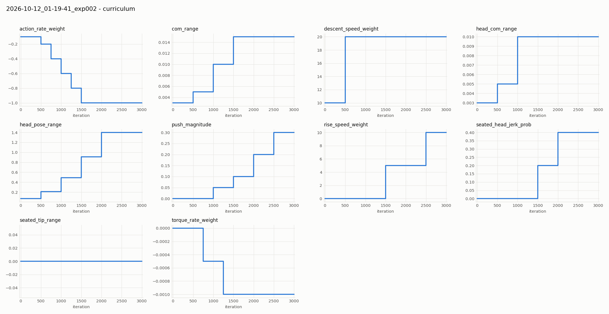
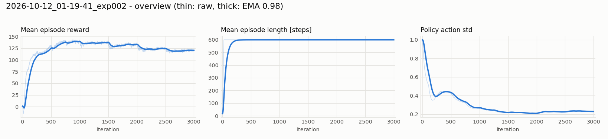
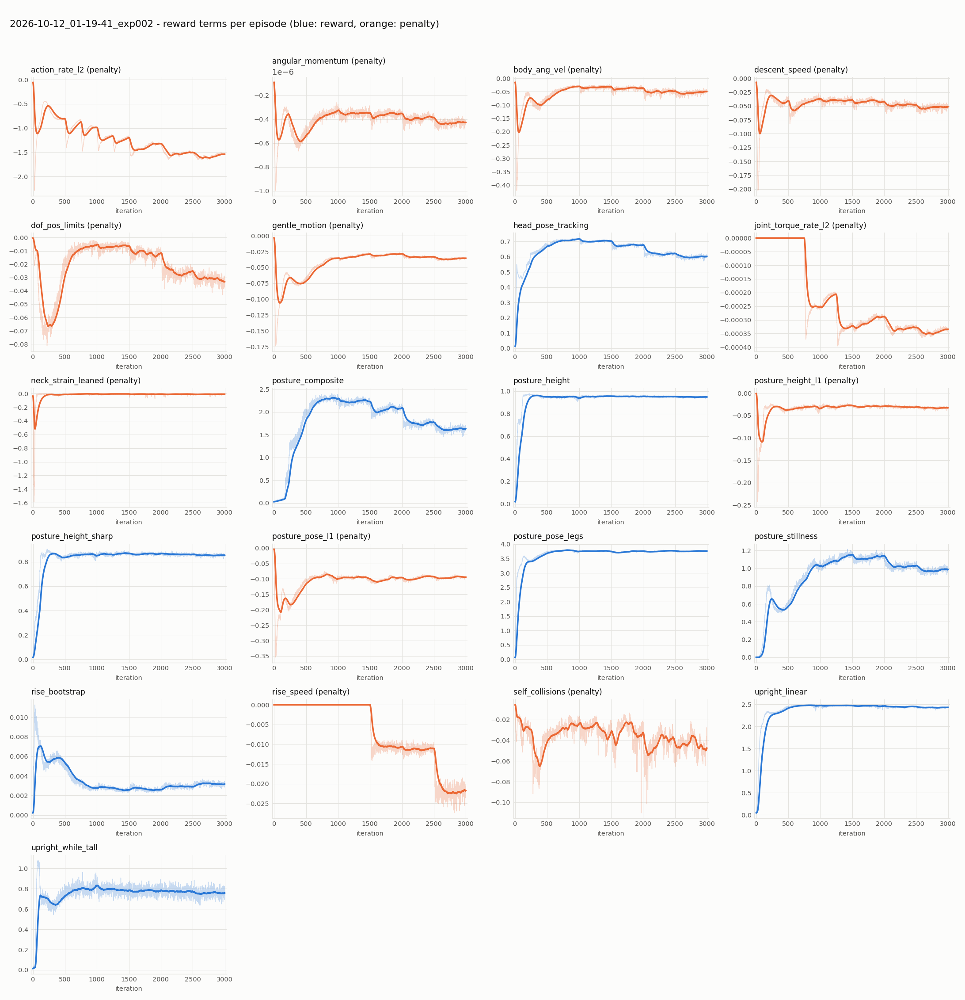
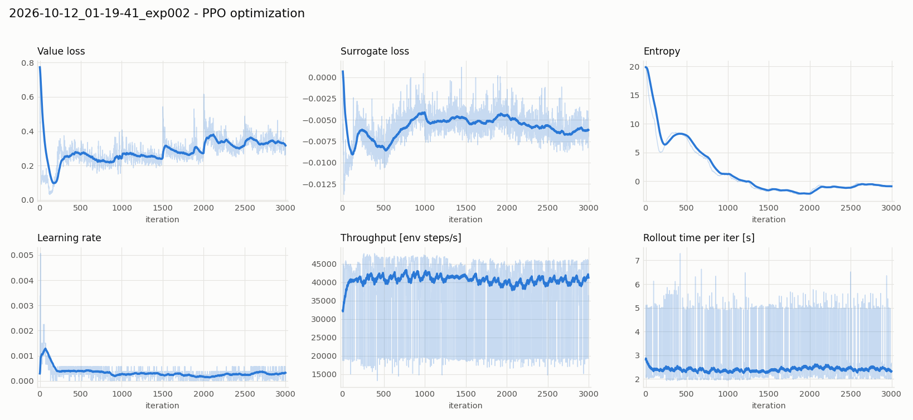
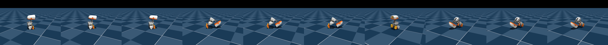
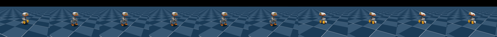
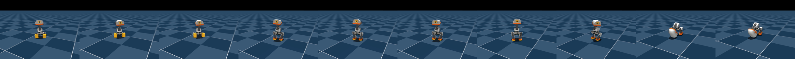
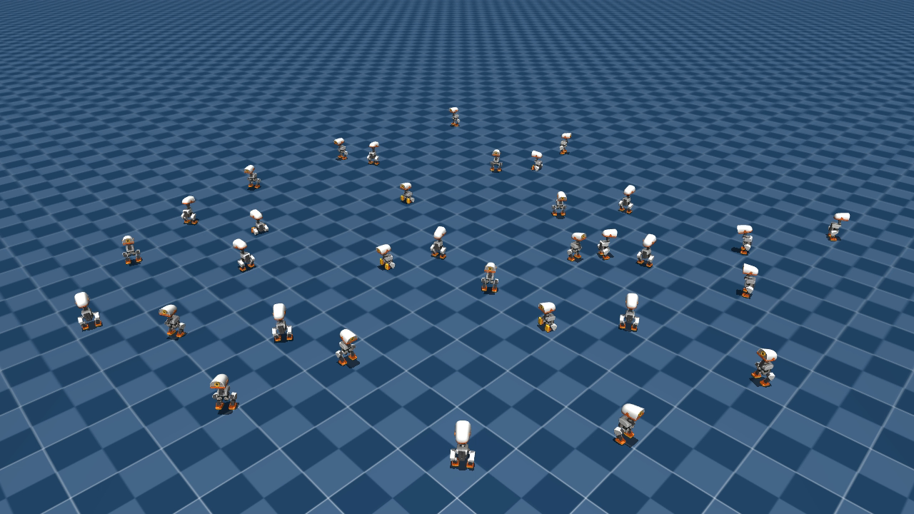
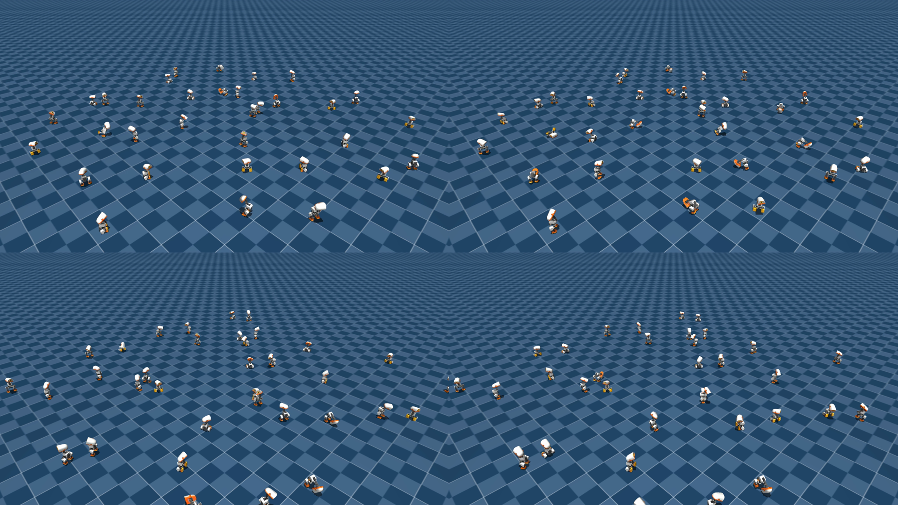

# exp002 学習サマリ: SitStand（座る ⇄ 立つ）

- run: `2026-10-12_01-19-41_exp002`（タスク `Mjlab-SitStand-Flat-MicroDuck`、公式設定を無改変・最初から学習）
- 実行環境: ローカル RTX 3090 / Docker、4096 並列環境、3000 iteration、所要 2 時間 07 分
- 設定の出典: `params/env.yaml`, `params/agent.yaml`、公式 cfg のドキュメント文字列、`docs/sitstand_policy.md`

---

## 1. 何を学習したか

**1 つの方策で「座る」と「立つ」を指令で切り替える。** 頭部姿勢指令にも、座位・立位の両方で追従する。

| 項目 | 内容 |
|---|---|
| 指令 | 速度指令スロットの vx を姿勢フラグとして流用: **0 = 立つ, 1 = 座る**（3.5〜6.5 秒ごとに切替, 座る確率 50%）。全ゼロ = 立つ = 他の方策と共通の待機状態 |
| 目標姿勢 | 座位: 膝 ±1.35 rad, 股関節ピッチ ∓0.41 rad, 胴体高さ 0.060 m ／ 立位: HOME 姿勢, 胴体高さ 0.115 m |
| エピソード | 12 秒 = 600 ステップ。**転倒による終了なし**（倒れても時間切れまで続き、自力で戻る必要がある） |
| ロボットモデル | 全身の衝突判定あり（膝つき・頭での支えなど、どんな経路も許可） |
| 方策モデル | exp001 と同じ（Actor/Critic とも MLP 512-256-128, ELU。観測 61 次元は全タスク共通） |

設計思想（公式 cfg より）: **経路は教えない**。各時刻の指令に応じて「座位」または「立位」の目標 1 つだけを報酬にし、
そこへどう移るか（膝から先に下ろす、頭で支える等）は方策に発見させる。

## 2. 報酬設計

### 2.1 正の報酬（目標姿勢への到達と静止）
| 項 | 重み | 意味 |
|---|---|---|
| `posture_pose_legs` | 4.0 | 脚の関節角が指令姿勢（座位/立位）の keyframe に近い（std 0.5） |
| `posture_composite` | 3.0 | **高さ × 直立 × 姿勢 × 頭部 の積**。どれか 1 つでも崩れるとほぼ 0 → 「板のように寝る」「傾いて誤魔化す」を防ぐ |
| `upright_linear` | 2.5 | 胴体の直立度 |
| `posture_stillness` | 2.0 | 指令高さ付近で静止している（傾き 25° 以内で満額、60° で 0） |
| `upright_while_tall` | 1.5 | 胴体が高い（0.075〜0.1 m 以上）ときの直立 |
| `posture_height` / `_sharp` | 1.0 / 1.0 | 胴体高さが指令高さに近い（std 0.04 / 0.015 m） |
| `head_pose_tracking` | 0.75 | 頭部姿勢指令への追従 |
| `rise_bootstrap` | 0.75 | 立ち上がりのきっかけ（上昇速度 0.08 m/s まで, 高さ 0.125 m まで）を少しだけ報酬 |

### 2.2 ペナルティ（やさしさと安全）
| 項 | 重み | 意味 |
|---|---|---|
| `descent_speed` | 10 → 20（カリキュラム） | 座る時の下降速度が 0.05 m/s を超えた分 |
| `rise_speed` | 0 → 5 → 10（1500 iter から） | 立つ時の上昇速度が 0.08 m/s を超えた分。**立ち上がりを覚えた後に導入**（最初からだと「立たない」が最適になる） |
| `posture_height_l1` / `posture_pose_l1` | 6.0 / 1.0 | 高さ・姿勢の誤差（L1） |
| `gentle_motion` | 0.05 | 鉛直加速度（衝撃） |
| `neck_strain_leaned` | -0.5 | 座位で後ろに 12〜25° 以上傾いた状態での首トルク（公式の既知欠点への対策） |
| `action_rate_l2` / `joint_torque_rate_l2` | -0.1→-1.0 / 0→-0.001 | 動作・トルクの急変 |
| `dof_pos_limits`, `self_collisions`, `body_ang_vel`, `angular_momentum` | -1, -1, -0.05, -0.02 | 可動域限界・自己衝突・余計な回転 |

### 2.3 カリキュラム

- 500〜2000 iter: 頭部姿勢範囲を段階的に拡大（exp001 と同じ）、重心ランダム化を拡大
- 1000〜2500 iter: **押し外乱**の強さ 0 → 0.3 m/s（早く入れると座り方を忘れる、という公式の教訓）
- 1500 iter〜: **座位での頭の急な動き**（確率 0.2 → 0.4）と **座位で後ろへ押す外乱**（角速度 1〜4 rad/s, 2500 iter で最大）。
  公式の既知欠点「座ったまま頭を急に動かすと後ろに倒れる」への耐性をつける段階
  （※ `seated_tip_range` のプロットが 0 のままなのはログ関数が範囲（タプル）を 0 と記録する仕様のためで、外乱は実際に加わっている）

## 3. 学習結果

### 3.1 全体の推移

| iter | 平均報酬 | `posture_composite` | `posture_stillness` | 頭部追従 | 方策 std |
|---|---|---|---|---|---|
| 0 | 9.2 | 0.05 | 0.00 | 0.40 | 0.81 |
| 250 | 114.4 | 1.28 | 0.58 | 0.62 | 0.42 |
| 500 | 125.1 | 1.99 | 0.63 | 0.68 | 0.40 |
| 1000 | **134.0** | **2.22** | 1.02 | **0.70** | 0.26 |
| 1500 | 129.1 | 2.02 | 1.10 | 0.67 | 0.22 |
| 2000 | 126.9 | 1.86 | 1.08 | 0.64 | 0.22 |
| 2999 | 120.5 | 1.63 | 0.98 | 0.60 | 0.23 |

- 250 iter で `posture_height` は 0.97 に達するが、これは報酬上の平均値。**指令どおりの姿勢になれているかは 4 章の評価を参照**（250 iter 時点では「立て」指令の半数以上が座位のまま後ろに傾いて立てない）。エピソード長は最初から 600（転倒終了がないため常に満了）。
- 報酬のピークは 1000 iter。以降は**押し外乱・頭の急な動き・後ろへの押し・上昇速度の制限が次々に加わり**、
  報酬・`posture_composite`・頭部追従がゆるやかに下がる。これは方策の劣化ではなく、課題が難しくなった分（exp001 と同じ構図）。
  ただし最終段（2500 iter）以降に持ち直す傾向はまだ見えず、**カリキュラムに対して学習量が足りていない可能性**がある。
- 公式の採用チェックポイントもベース run の 1250 iter と、追加学習後の 2250 iter（外乱強化の途中〜直後）。

### 3.2 報酬項ごとの推移

- 姿勢系（`posture_height`, `posture_pose_legs`, `upright_linear`）は 250〜500 iter で飽和し、最後まで維持。
- `posture_composite` と `posture_stillness` が外乱導入のたびに段状に下がる → 押されて静止が崩れる時間が増えている。
- `rise_speed` は 1500 / 2500 iter の重み増加に合わせて負に深くなる（重みの増加分。ゆっくり立つ方向へ圧力）。
- 全ペナルティ項が ≤ 0（公式 AGENTS.md の健全性チェック OK。self-negating 型の `descent_speed` などは正の重みで負値になる仕様どおり）。

### 3.3 最適化

---

## 4. 指令どおりの姿勢になれているか（1024 体, ヘッドレス評価）

`experiments/common/eval_sitstand.py`（結果 JSON は `eval/`）。指令（座る/立つ）が切り替わってから 2.5 秒以上たった時点で、
- **成功**: 座位 = 胴体高さ 0.060±0.015 m かつ傾き < 25°、立位 = 0.115±0.015 m かつ傾き < 20°（頭部が床についていない）
- **傾いたまま**: 傾き 25〜60°（座位から立ち上がれず後ろに傾いて止まる等）
- **指令と逆**: 座れ指令で立位の高さのまま／立て指令で座位の高さのまま

### 4.1 各チェックポイントが学習していた時点の条件（押し外乱・座位での頭の急な動き・後ろへの押しを含む）

（各チェックポイントに保存されたカリキュラムの進み具合のまま評価。model_2250 は 2250 iter 時点の外乱の強さ、model_2999 は最終段）

| チェックポイント | 座れ: 成功 | 座れ: 立ったまま | 立て: 成功 | 立て: 傾いたまま | 立て: 座ったまま |
|---|---|---|---|---|---|
| model_250 | 71% | 29% | 37% | **56%** | 7% |
| model_1000 | 59% | **40%** | 96% | 4% | 1% |
| model_2250 | **93%** | 6% | **89%** | 11% | 0% |
| model_2999 | 92% | 7% | 79% | **21%** | 0% |

### 4.2 外乱なし・頭部指令の範囲も最小（カリキュラム最易段）

| チェックポイント | 座れ: 成功 | 座れ: 立ったまま | 立て: 成功 | 立て: 傾いたまま |
|---|---|---|---|---|
| model_250 | 72% | 28% | 37% | 56% |
| model_1000 | 40% | **60%** | 100% | 0% |
| model_2250 | 67% | **33%** | 99% | 1% |
| model_2999 | 65% | **35%** | 100% | 0% |

### 4.3 読み取れること
- **最も良いのは model_2250**（自身の学習時点の条件で 座る 93% / 立つ 89%）。公式が採用したのも 2250 iter のチェックポイントだった。
  ただし最終段の外乱（押し 0.3 m/s, 後ろへの押し 2〜4 rad/s）では立つ成功率は 75〜78% 程度に下がる（4.4 の A 参照）。
- **model_2999 は立ち上がりが悪化**: 「立て」指令の 21% が座位のまま後ろに 25〜60° 傾いて止まる。
  動画で「頭が地面についたまま」に見えたのはこの状態（斜め上からのカメラだと寝ているように見える）。
  公式ドキュメントの既知欠点（座位で後ろに傾いたまま首が過負荷）と同じ。
- **外乱のない条件では、「座れ」指令の約 1/3 で立ったまま座らない**（2250 / 2999 とも）。外乱のある条件より悪い。
  実機（外乱なし）に近いのはこちらなので、実用上は重要な欠点。原因（どのカリキュラム項目の違いが効いているか）は未調査。
- model_250 は立ち上がりがほとんどできておらず（56% が傾いたまま）、「250 iter で座る/立つを獲得」という当初の記述は誤りだった。

### 4.4 切り分け: どの条件の違いが効いているか（model_2250）

外乱・指令に影響するカリキュラム 6 項目を 1 つずつ入れ替えて評価した（`eval_sitstand.py --pin 項目=first|last`, 結果 JSON は `eval/ablation/`）。

| 条件 | 座れ: 成功 | 立て: 成功 |
|---|---|---|
| 最易段（基準） | 67% | 99% |
| B: 最易段 ＋ **頭部指令の範囲だけ最終段** | **91%** | 99% |
| B: 最易段 ＋ **押し外乱だけ最終段** | 83% | **78%** |
| B: 最易段 ＋ 重心 / 頭部重心 / 座位の頭の急な動き / 座位で後ろへの押し だけ最終段 | 65〜71% | 99〜100% |
| 最終段（3000 iter 相当, A の基準相当） | — | 75〜78%（A の他項目の結果より） |
| A: 最終段 ＋ **押し外乱だけ最易段（なし）** | 91% | **97%** |
| A: 最終段 ＋ **頭部指令の範囲だけ最易段** | **85%** | 78% |
| A: 最終段 ＋ 他の 1 項目だけ最易段 | 92〜95% | 75〜78% |

- **「外乱なしで座らない」の主因は頭部指令の範囲**。頭部指令がほぼゼロ（±0.05 rad）だと「座れ」の 1/3 を無視するが、
  頭部指令が大きく動いていれば 91% 座る。学習後半は頭部指令が常に大きく振られるため、
  「頭をほとんど動かさない状態で座る」経験が少ないと考えられる。**実機で頭を静止させたまま座らせる場面に直結する欠点**。
  AGENTS.md の教訓「ゼロ指令での挙動は明示的に学習させる必要がある」と同じ構図。
- **「立てずに後ろに傾いたまま」の主因は押し外乱**。押しをなくすと立つ成功率は 97% に戻り、押しだけ入れると 78% に落ちる。
  座位で押されて後ろに傾くと、そこから立ち上がれない。

### 4.5 評価方法についての注意（訂正）
当初この章に載せていた転倒率の表は、評価スクリプトの不具合で誤っていたため削除した。
`runner.load()` がチェックポイントに保存されたカリキュラムの進み具合（step 72000）を環境に書き戻すため、
指定したつもりの段階が最初のエピソードにしか効いていなかった。動画も同じで、**最初の 12 秒は最易段、
それ以降は学習終了時の段階**で撮れていた（`record_video.py` / `evalutil.py` を修正済み）。

## 5. 動画

各 20 秒、ランダムな座る/立つ指令・頭部指令。サムネイルは 2 秒ごと。

### iter 250
[videos/model_250.mp4](videos/model_250.mp4)

座る・立つの切替はできているが、座位が「後ろに倒れ込んで寝る」に近い崩れた姿勢になる場面が多い。

### iter 1000（報酬ピーク付近）
[videos/model_1000.mp4](videos/model_1000.mp4)

### iter 2999（最終）
[videos/model_2999.mp4](videos/model_2999.mp4)

※ 最初の 12 秒は最易段、以降は学習終了時の段階のカリキュラムで動いている（4.5 参照）。
0〜3 秒は座位、4〜11 秒は立位で頭部指令に追従。12 秒以降のエピソードで、座位から立ち上がれず後ろに傾いて止まる（4.1 の「立て: 傾いたまま」21% に相当）。

### 36 体（最終）
[videos/multi36_model_2999.mp4](videos/multi36_model_2999.mp4)

立っている個体と座っている個体が混在し、それぞれ指令に応じて切り替わる。

### 36 体（model_2000, 2026-10-13 追加）
[videos/multi36_model_2000.mp4](videos/multi36_model_2000.mp4)（20 秒, 50 fps。カリキュラムは 2000 iter 時点の段階で統一、座る/立つ・頭部指令はランダム）

0.3 秒 / 9 秒 / 15 秒 / 19 秒:

座っている個体（足の黄色い部品が見える）と立っている個体が混在し、指令に応じて切り替わる。録画中の姿勢ログでは、
最初のエピソード（0〜12 秒）で 1〜2 体が押し外乱で完全に転倒（最大 174°）し、10 秒時点で 9 体が 30° 以上傾いた。
2 エピソード目（12〜20 秒）は 30° 以上が最大 3 体、60° 超の転倒なし。

model_2000 の評価（`eval_sitstand.py`, 頭部指令ゼロ固定）: 外乱なし 座る 96% / 立つ 99.6%、2000 iter 時点の外乱あり 座る 96% / 立つ 93%。
外乱なしで頭を静止した条件での「座る」はチェックポイントごとに大きく揺れ（2000: 96%, 2250: 64%, 2999: 62%）、
現時点で測った中では model_2000 が最もバランスが良い（全チェックポイントの比較は未実施）。

---

## 6. まとめと次の一手

- 公式設定のまま 3000 iter（2 時間 07 分）で全カリキュラムを通過。
- **最良は model_2250**（学習終了時の条件で 座る 93% / 立つ 89%）。最終の model_2999 は「立て」指令の 21% で座位のまま後ろに傾いて止まる。
- **外乱のない条件では「座れ」指令の約 1/3 を無視して立ったまま**。主因は頭部指令がほぼゼロであること（4.4）。
- **最終段の押し外乱下では「立て」指令の約 1/4 で座位のまま後ろに傾いて立てない**（4.4）。
- 次の候補:
  1. 頭部指令をゼロ付近にする割合（ゼロ指令バケット）を学習に加え、頭を静止したままでも座れるようにする
  2. 同じタスクを resume で延長（公式の Stage 2 と同じ扱い）し、4 章の評価で改善するかを確認
  3. 実用には当面 model_2250 を採用
