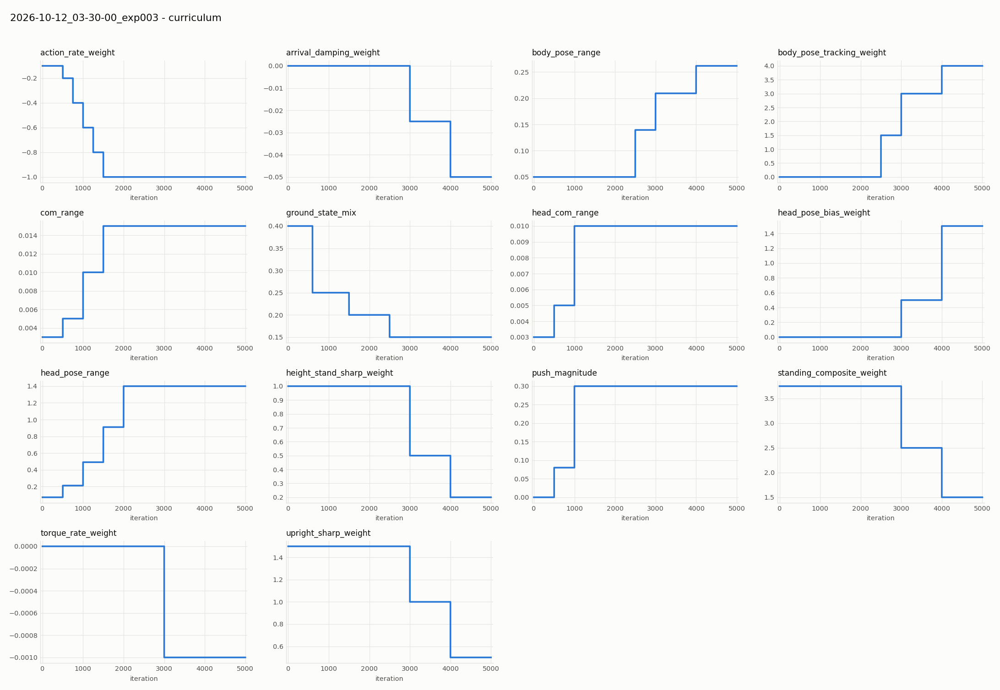
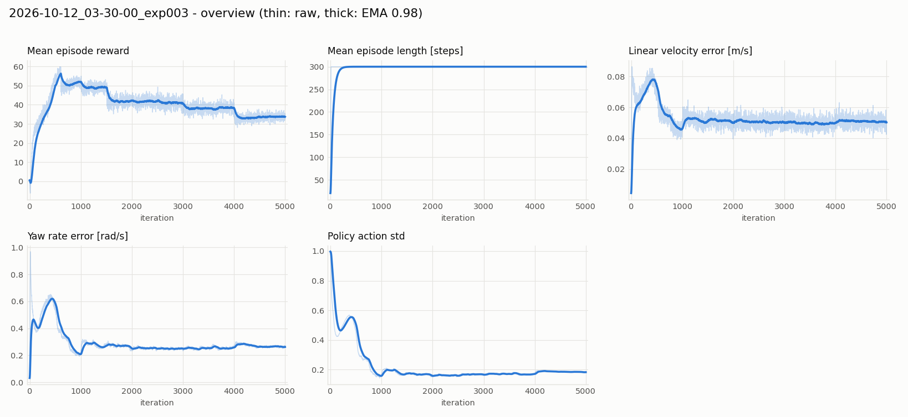
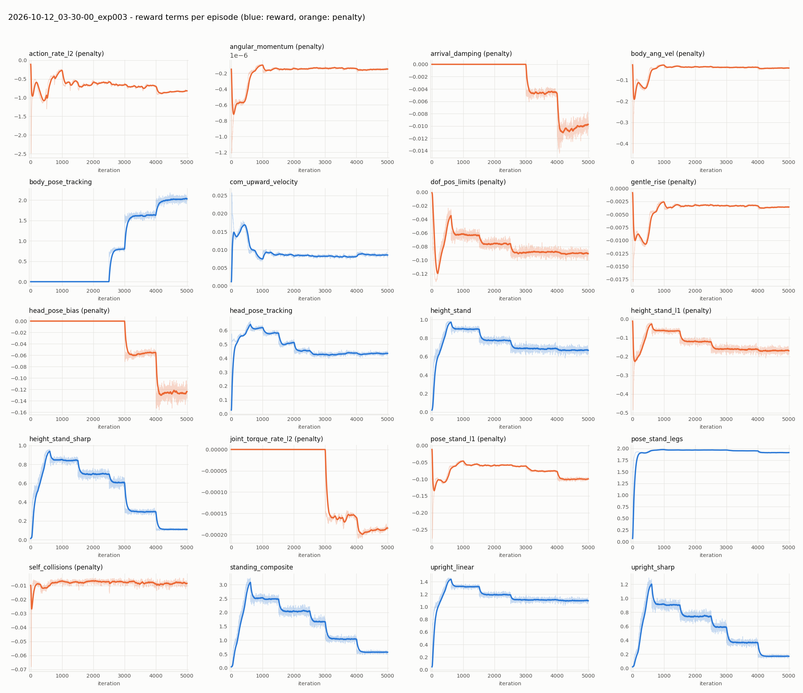
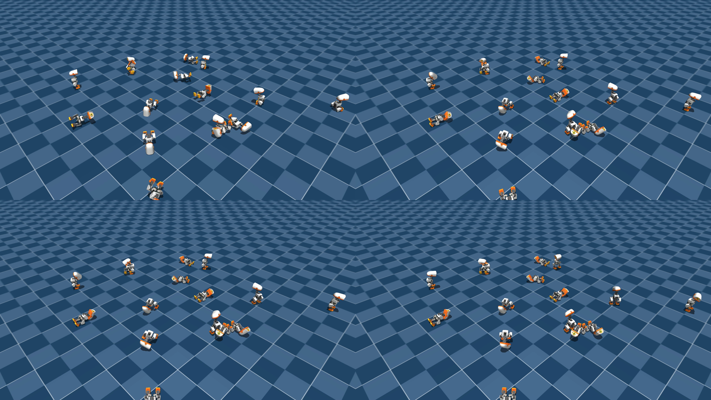

# exp003 学習サマリ: StandUp（起き上がり）— 倒れた状態からの起き上がりは未獲得

- run: `2026-10-12_03-30-00_exp003`（タスク `Mjlab-StandUp-Flat-MicroDuck`、公式設定を無改変・最初から学習, seed 42）
- 実行環境: ローカル RTX 3090 / Docker、4096 並列環境、5000 iteration、所要 3 時間 19 分
- **結論: 座位からの起立と立位の保持はできるが、うつ伏せ・仰向け・横向きからの起き上がりは一度も成功しない。**
  exp004（VelStand）の stand expert には使えない。

---

## 1. 何を学習するタスクか

| 項目 | 内容 |
|---|---|
| 初期姿勢 | 立位・座位・うつ伏せ（face-down）・仰向け（face-up, ±90° の横ロールのばらつき付き）を確率で混ぜる。`ground_state_mix` カリキュラムで難しい姿勢の割合を増やす（下表） |
| 目標 | 立位（HOME 姿勢, 胴体高さ約 0.12 m）に到達して保持。経路は指定しない |
| エピソード | 6 秒 = 300 ステップ |
| 立った後 | 頭部姿勢指令、2500 iter からは胴体姿勢指令（高さ・ロール・ピッチ）にも追従 |

| iter | 立位 | 座位 | うつ伏せ | 仰向け |
|---|---|---|---|---|
| 0 | 40% | 40% | 20% | 0% |
| 600 | 25% | 30% | 35% | 10% |
| 1500 | 20% | 25% | 30% | 25% |
| 2500〜 | 15% | 20% | 30% | 35% |

主な報酬: `standing_composite`（高さ×直立×姿勢の積）, `height_stand`, `upright_linear`, `pose_stand_legs`,
`com_upward_velocity`（上昇速度, 0.125 m まで）、立った後の `head_pose_tracking` / `body_pose_tracking`。
公式の教訓として、**起き上がりを発見する前に「試行への課税」（動きのペナルティ）を入れると発見できなくなる**ため、
`arrival_damping` や `joint_torque_rate` などの平滑化は 3000 iter 以降に導入される。

## 2. 学習曲線

- 報酬・`height_stand`・`standing_composite`・`upright_sharp` が **1500 / 2500 iter（うつ伏せ・仰向けの割合が増える段）で段状に下がり、戻らない**。
  3000 / 4000 iter の下落は正の報酬の重みそのものを下げるカリキュラム（`standing_composite_weight` 3.75→1.5 など）による。
- 公式 cfg のコメントに、まさにこの形が **「失敗した run の特徴」** として記録されている:
  > standing metrics drop at the ground_state_mix stages (1500/2500) instead of recovering like the reference run
  > … face-up/face-down recovery never got learned.
- 同じく cfg には「仰向けからの起き上がりはシード頼みで、同等の報酬で 1 勝 3 敗だった」とある。

## 3. 起き上がり成功率（2048 体, 学習最終段の初期姿勢分布, ヘッドレス評価）

`experiments/common/eval_standup.py`。reset 直後の重力方向で初期姿勢を分類し、6 秒のエピソード中に
「傾き < 20° かつ 胴体高さ > 0.10 m」に一度でも到達したか（ever）と、終了時点で立っているか（end）を数えた。

| チェックポイント | 座位など（end / ever） | うつ伏せ | 仰向け | 横向き |
|---|---|---|---|---|
| model_750 | 24% / 78% | 0% / 0% | 0% / 0% | 0% / 0% |
| model_2500 | 98% / 100%（中央値 0.22 秒） | **0% / 0%** | **0% / 0%** | **0% / 0%** |
| model_4999 | 99% / 100%（中央値 0.24 秒） | **0% / 0%** | **0% / 0%** | **0% / 0%** |

（各グループ 350〜700 体。公式の stand expert はうつ伏せ・仰向け 100%、横向き 95% を約 1 秒で起き上がると記載）

## 4. 映像による確認

学習最終段の初期姿勢分布で 16 体を録画（[videos/multi16_model_4999_curr5000.mp4](videos/multi16_model_4999_curr5000.mp4)）。
0 秒 / 1 秒 / 3 秒 / 5.8 秒:

座位・立位で始まった個体は立っているが、うつ伏せ・仰向けの個体は最後まで寝たまま。
頭を床につけて脚を浮かせた姿勢で止まる個体もある。

## 5. 考察と次の一手

- 失敗の形は公式が記録した「起き上がりを発見できなかった run」と同じ。公式によれば発見はシードに左右される。
- 方策の std は 1000 iter までに 0.2 前後まで縮んでおり、それ以降は寝た状態から偶然起き上がる探索がほぼ起きない
  （VelStand が expert からの蒸留を必要とした理由と同じ構図）。
- 次の候補:
  1. **シードを変えて再学習**。うつ伏せは学習開始時から 20% 混ざっているので、発見できたかは 1000 iter 程度で
     `eval_standup.py` により判定できる。発見した run だけを 5000 iter まで続ける
  2. 公式 HF Hub の `alpha_stand.onnx`（stand expert）の重みを rsl_rl のチェックポイント形式に変換して exp004 に使う
     （自前のモデルではなくなる）
