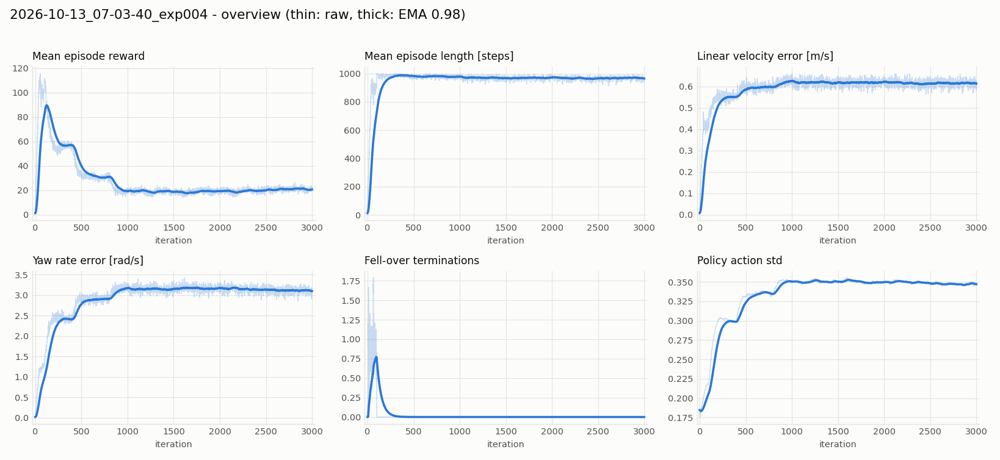
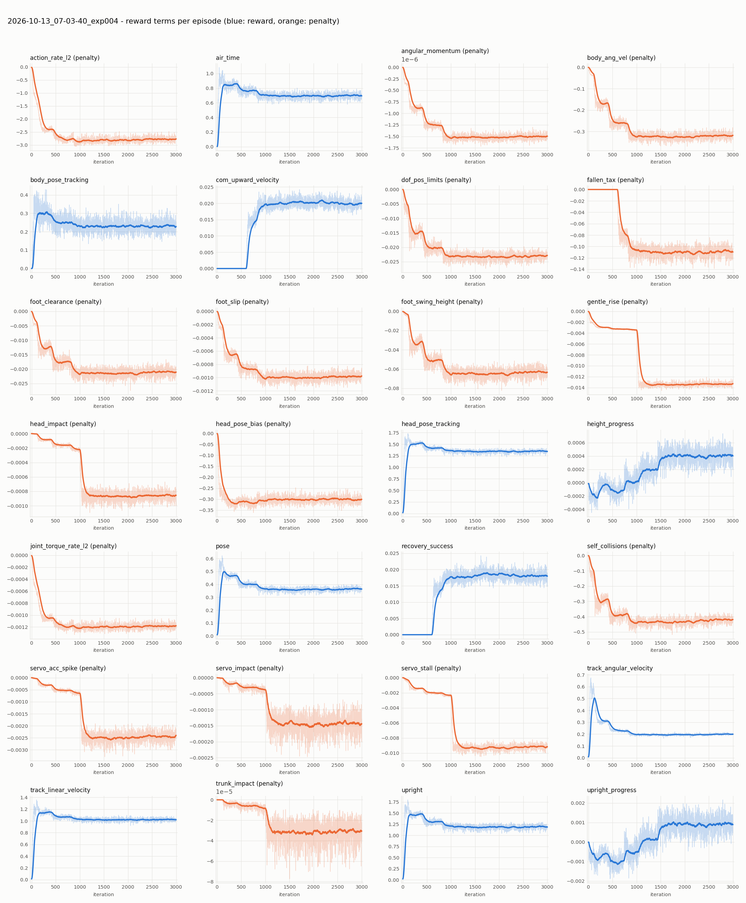

# exp004 学習サマリ: VelStand（歩行 + 転倒時の保護 + 起き上がり）

- run: `2026-10-13_07-03-40_exp004`（タスク `Mjlab-VelStand-Flat-MicroDuck`, 3000 iter, 4096 envs）
- 公式 VelStand のレシピを自前の歩行モデルで再現:
  - **warm start**: exp001 の歩行方策 `model_2999.pt`（重み・観測正規化・optimizer を引き継ぎ、`MICRODUCK_WARM_START=1` で iteration とカリキュラムは 0 から）
  - **蒸留（公式 `distill.py`）**: 倒れた状態（傾き > 35°）は stand expert を、立っている状態（傾き < 25°）は exp001 の歩行を教師に behavior cloning
  - **stand expert = 公式 `alpha_stand.onnx`**（HF Hub, Apache-2.0）を `convert_onnx_teacher.py` で変換したもの。
    自前の StandUp（exp003 / exp005, 4 シード）は倒れた状態からの起き上がりを発見できなかったため
- 学習中は寝た姿勢からの開始割合が 0 → 45% に増え、転倒による終了は 2400 step で無効化、倒れさせる押し（topple push）も入る

## 1. 寝た姿勢からの起き上がり（512 体, 全員寝た姿勢から開始, 20 秒, `eval_standup.py --all-prone`）

各セル: 一度でも立てた割合 / 20 秒後に立っている割合 / 立つまでの中央値

| チェックポイント | うつ伏せ | 仰向け | 横向き |
|---|---|---|---|
| model_1000 | 100% / 71% / 0.30 s | 97% / 75% / 0.72 s | 98% / 67% / 0.76 s |
| model_2000 | 100% / 77% / 0.30 s | 99% / 82% / 0.66 s | 100% / 72% / 0.70 s |
| model_2999 | 100% / 76% / 0.32 s | 100% / 78% / 0.66 s | 100% / 75% / 0.74 s |

- **寝た姿勢からほぼ全員（98〜100%）が 1 秒以内に起き上がる**（中央値 0.3〜0.8 秒）。自前の StandUp（0%）からは大きな前進。
- 20 秒後に立っている割合は 67〜82%。起き上がった後も最終段の倒れさせる押し（topple push）が入り続けるため、評価終了時点で倒れている個体を含む。

## 2. 歩行中の転倒（512 体, 20 秒, 傾き 60° 超を転倒とする, `eval_falls.py`, カリキュラム最易段）

| 方策 | 20 秒間に転倒した割合 | 転倒回数 / 体・分 |
|---|---|---|
| exp004 model_2999（VelStand） | 17.6% | 0.59 |
| exp001 model_2999（歩行のみ） | 5.3% | 0.16 |

- VelStand は歩行専用モデルより転びやすい（約 3 倍）。ただし転んでも起き上がれる。
- 注意: 歩行タスクの押し外乱はカリキュラムに依存しない設定のため、「最易段」でも押しは入っている。速度追従の精度は未評価。

## 3. 学習曲線

## 4. まとめ
- 公式 stand expert を教師にすることで、**歩行しつつ、転んでも 1 秒以内に起き上がる方策**が得られた。
- 歩行の転倒率は歩行専用モデルの約 3 倍。速度追従・頭部/胴体姿勢指令・転倒時の衝撃（servo/head impact）の評価は未実施。
- 動画は未作成。
