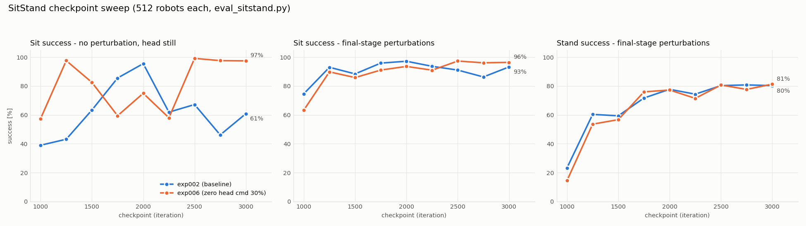
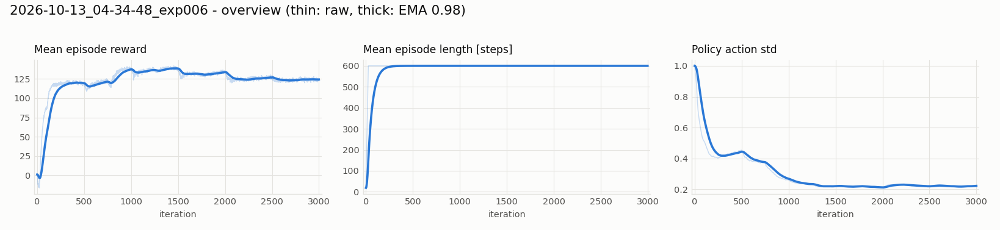
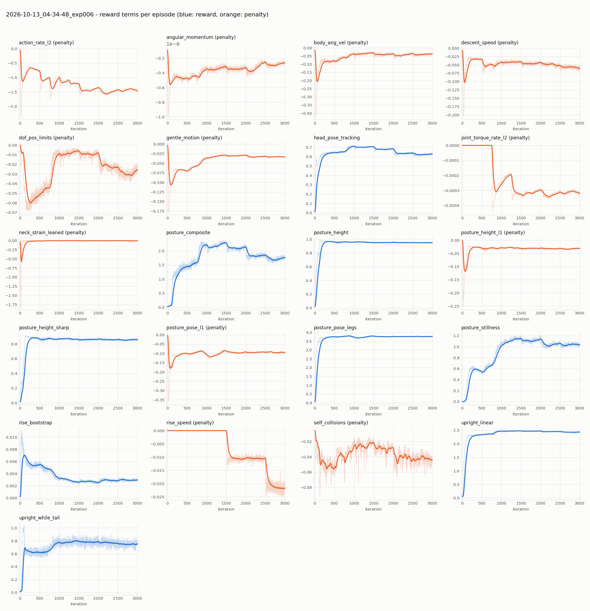

# exp006 学習サマリ: SitStand + 頭部指令のゼロ指令バケット

- run: `2026-10-13_04-34-48_exp006`（タスク `Mjlab-SitStand-Flat-MicroDuck`）
- **exp002 との違いは 1 点だけ**: `commands.head_pose.zero_command_prob = 0.3`（頭部指令の再サンプル時に 30% で全ゼロ）。
  公式実装済みの機能で SitStand では 0 だったもの。`train_sitstand.py` が起動時に設定（サブモジュールは無改変）
- その他は exp002 と同一（最初から学習, 4096 envs, 3000 iter, seed 42）。モデル・報酬・カリキュラムの解説は
  [exp002 の summary](../../../exp002_sitstand/outputs/2026-10-12_01-19-41_exp002/summary.md) を参照

## 1. 動機
exp002 では、外乱がなく頭部指令もほぼゼロの「静かな」条件で「座れ」指令を無視することが多かった
（チェックポイントにより 39〜96%）。学習後半は頭部指令が常に大きく振られ、押し外乱も入るため、
「何も動かない状態で座る」経験が少ないと考えた。実機（外乱なし・頭を静止）に直結する欠点。

## 2. 結果: チェックポイント別の比較（512 体, `common/eval_sitstand.py`）

| iter | 静かな条件 座る: exp002 | exp006 | 最終段の外乱 座る: exp002 | exp006 | 最終段の外乱 立つ: exp002 | exp006 |
|---|---|---|---|---|---|---|
| 1000 | 39% | **57%** | 75% | 63% | 23% | 14% |
| 1250 | 43% | **98%** | 93% | 90% | 60% | 54% |
| 1500 | 63% | **83%** | 88% | 86% | 59% | 57% |
| 1750 | 86% | **59%** | 96% | 91% | 72% | 76% |
| 2000 | 96% | **75%** | 97% | 94% | 78% | 77% |
| 2250 | 62% | **58%** | 94% | 91% | 74% | 71% |
| 2500 | 67% | **99%** | 91% | 97% | 80% | 81% |
| 2750 | 46% | **98%** | 86% | 96% | 81% | 78% |
| 2999 | 61% | **97%** | 93% | 96% | 80% | 81% |

- 「静かな条件」= 外乱なし（カリキュラム最易段）＋頭部指令ゼロ固定。「最終段の外乱」= 3000 iter 相当の外乱＋通常の頭部指令。
- **静かな条件での「座る」が、exp006 では 2500 iter 以降 97〜99% で安定**。exp002 は同じ区間で 46〜67%。
  2000 iter までは両 run とも 39〜98% と大きく揺れており、この区間の差は判断できない。
- 外乱下の成績は両 run でほぼ同じ（座る 86〜97%, 立つ 72〜81%）。ゼロ指令バケットによる悪化は見られない。
- **残る課題は外乱下の「立つ」（約 80%）**。exp002 の切り分けで原因は押し外乱（座位で押されて後ろに傾き、立ち上がれない）と分かっている。

## 3. 座るときに頭を床につくか（`common/head_contact_probe.py`, 立つ 2 秒 → 座る 4 秒 × 10, 32 体）

| | 頭が床に触れた個体 | 座れ指令中の接触時間 | 最大接触力 |
|---|---|---|---|
| exp002 model_2000 | 31 / 32 | 1.8% | 71 N |
| **exp006 model_2999** | **3 / 32** | **0.1%** | 66 N |

exp002 は座るたびに頭部前面を床について支える座り方をする（exp002 summary 参照）。exp006 model_2999 はほとんど頭をつかずに座る。
ただし接触が起きたときの力は同程度（66 N）。頭部の接触を罰する報酬は入れていないので、この差が意図した効果なのかは不明。

## 4. 学習曲線

## 5. まとめ
- 頭部指令のゼロ指令バケット（30%）で、**静かな条件でも座れる**方策が学習後半に安定して得られた（2500〜2999 で 97〜99%）。
- 現時点の最良候補は **exp006 model_2999**（静かな条件 座る 97% / 立つ 100%、最終段の外乱 座る 96% / 立つ 81%）または model_2500。
- 注意: seed 1 本ずつの比較。exp002 も 2000 iter では 96% を出しており、別シードでの再現確認はしていない。
- 座るときに頭を床につく頻度も exp006 model_2999 は低い（32 体中 3 体, exp002 model_2000 は 31 体）。
- 次の候補: 押し外乱下で座位から立ち上がれない問題（立つ 約 80%）、頭部の床接触ペナルティ（公式 VelStand の head_impact に相当）の追加。
