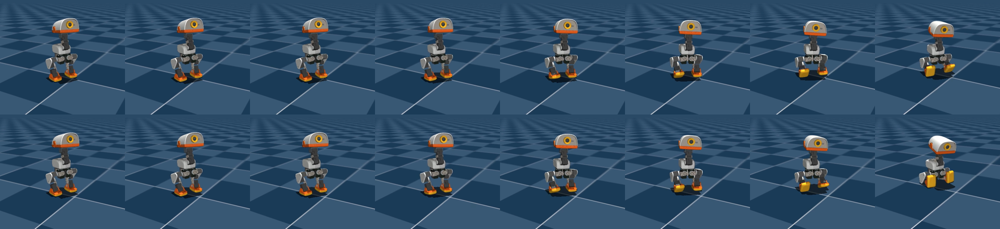
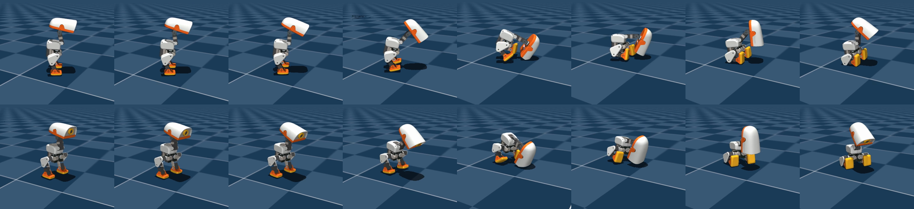
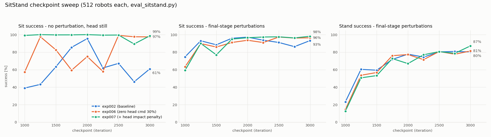
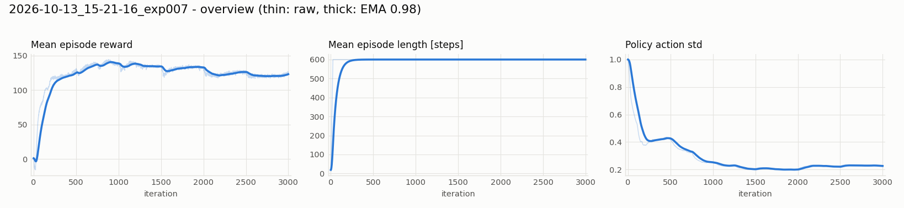
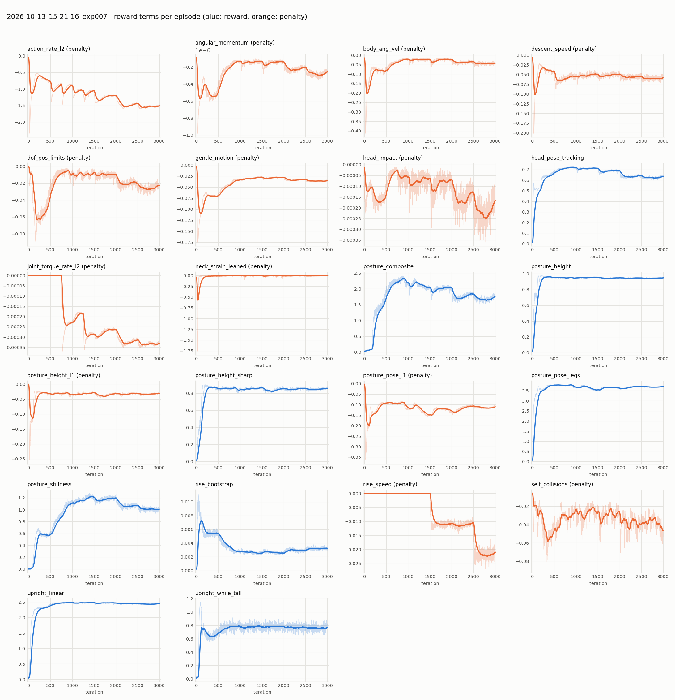

# exp007 学習サマリ: SitStand + 頭部の床衝撃ペナルティ（exp006 ベース）

- run: `2026-10-13_15-21-16_exp007`（タスク `Mjlab-SitStand-Flat-MicroDuck`, 最初から 3000 iter, seed 42, 4096 envs）
- exp006（頭部指令のゼロ指令 30%）に **頭部の床衝撃ペナルティ** を追加:
  - 接触センサー: 頭部ボディ（neck, neck_pitch, yaw_roll_motion, jaw_soft）↔ terrain の合力
  - `head_impact` = 15 N を超えた分 [N] × -0.02（公式 VelStand の `body_impact_cost` と同じ関数・閾値。重みは公式の 2 倍）
  - 750 iter までは重み 25%（座る動作の発見を妨げないため）、以降 100%
  - 公式 `HEAD_BODY_NAMES` の `bearing_roll`（右股関節リンク, 公式コメントで誤記と明記）は除外
- モデル・報酬・カリキュラムの解説は [exp002 の summary](../../../exp002_sitstand/outputs/2026-10-12_01-19-41_exp002/summary.md) を参照

## 1. 頭を床にぶつけるか（`common/head_contact_probe.py`, 立つ 2 秒 → 座る 4 秒 × 10, 32 体, 外乱なし）

| | 頭が床に触れた個体 | 座れ指令中の接触時間 | 最大接触力 |
|---|---|---|---|
| exp002 model_2000 | 31 / 32 | 1.8% | 71 N |
| exp006 model_2999 | 3 / 32 | 0.1% | 66 N |
| exp007 model_2500 | 0 / 32 | 0.0% | 0 N |
| exp007 model_2999 | 1 / 32 | 0.1% | 55 N |

座る場面の比較（0.1 秒刻み, 上段 2.2〜2.9 秒, 下段 8.2〜8.9 秒）。exp002 は前かがみで頭部前面を床について支えるが、
**exp007 は上体を起こしたまま膝を曲げてまっすぐ腰を落とす**:

exp007 model_2999:

exp002 model_2000（参考）:

## 2. 座る・立つの成功率（512 体, `common/eval_sitstand.py`）

各セルは exp002 / exp006 / **exp007**（%）。

| iter | 静かな条件 座る | 最終段の外乱 座る | 最終段の外乱 立つ |
|---|---|---|---|
| 1000 | 39 / 57 / **99** | 75 / 63 / **59** | 23 / 14 / **13** |
| 1250 | 43 / 98 / **100** | 93 / 90 / **90** | 60 / 54 / **51** |
| 1500 | 63 / 83 / **100** | 88 / 86 / **77** | 59 / 57 / **53** |
| 1750 | 86 / 59 / **100** | 96 / 91 / **95** | 72 / 76 / **73** |
| 2000 | 96 / 75 / **100** | 97 / 94 / **96** | 78 / 77 / **67** |
| 2250 | 62 / 58 / **99** | 94 / 91 / **97** | 74 / 71 / **77** |
| 2500 | 67 / 99 / **100** | 91 / 97 / **98** | 80 / 81 / **81** |
| 2750 | 46 / 98 / **89** | 86 / 96 / **96** | 81 / 78 / **79** |
| 2999 | 61 / 97 / **99** | 93 / 96 / **98** | 80 / 81 / **87** |

- **静かな条件（外乱なし・頭静止）の「座る」が 1000 iter から 89〜100% で安定**（exp002・exp006 は 2000 iter まで大きく揺れた）。
  頭で支える座り方ができなくなったことで、頭部指令の有無に左右されない座り方に収束したと考えられる（推測）。
- 外乱下の「座る」は 3 run でほぼ同じ。**外乱下の「立つ」は model_2999 で 87%**（exp002 80%, exp006 81%）。
  これは 1 チェックポイントの値で、2500〜2750 では 3 run とも 78〜81% なので、改善と言い切るには追加確認が必要。

## 3. 動画
[videos/sitstand_single_60s_model_2999.mp4](videos/sitstand_single_60s_model_2999.mp4)（60 秒, 立つ 2 秒 → 座る 4 秒 × 10, 外乱なし・頭静止）

## 4. 学習曲線

## 5. まとめ
- 頭部の床衝撃ペナルティで、**座るときに頭を床にぶつける動作がほぼ消えた**（32 体中 0〜1 体, exp002 は 31 体）。
- 副作用はなく、むしろ静かな条件での座る成功率が学習の早い段階から安定した。
- **現時点の最良候補は exp007 model_2999**（静かな条件 座る 99% / 立つ 100%、最終段の外乱 座る 98% / 立つ 87%、頭部接触 1/32 体）。
- 残る課題: 押し外乱下で座位から立ち上がれないケース（約 13%）。seed 1 本ずつの比較である点にも注意。
